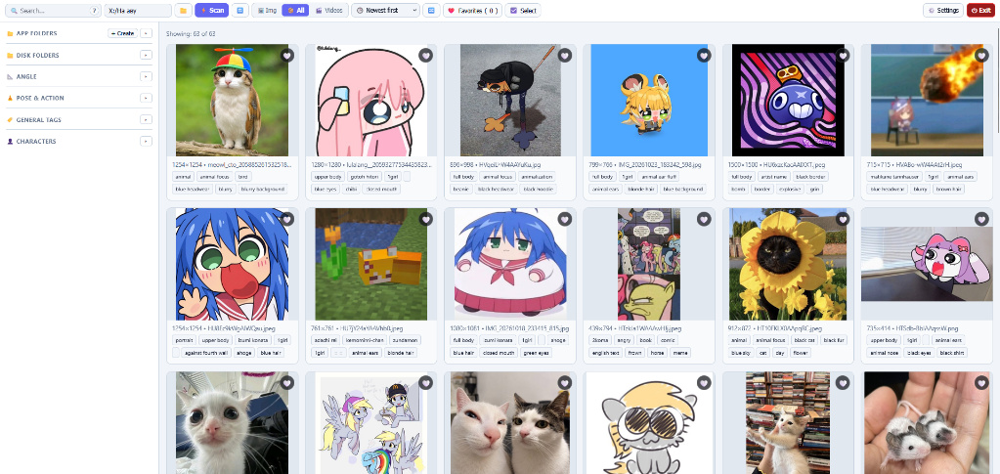
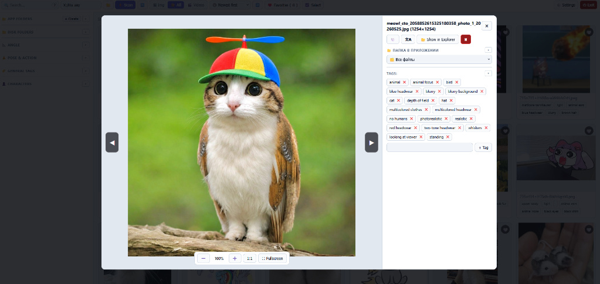
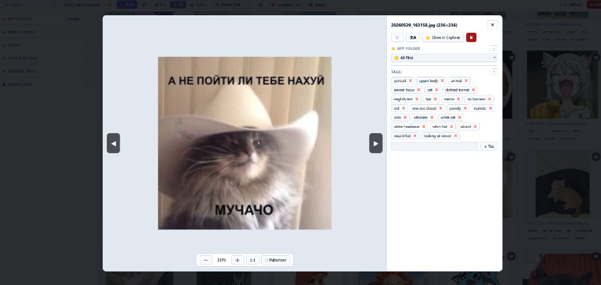
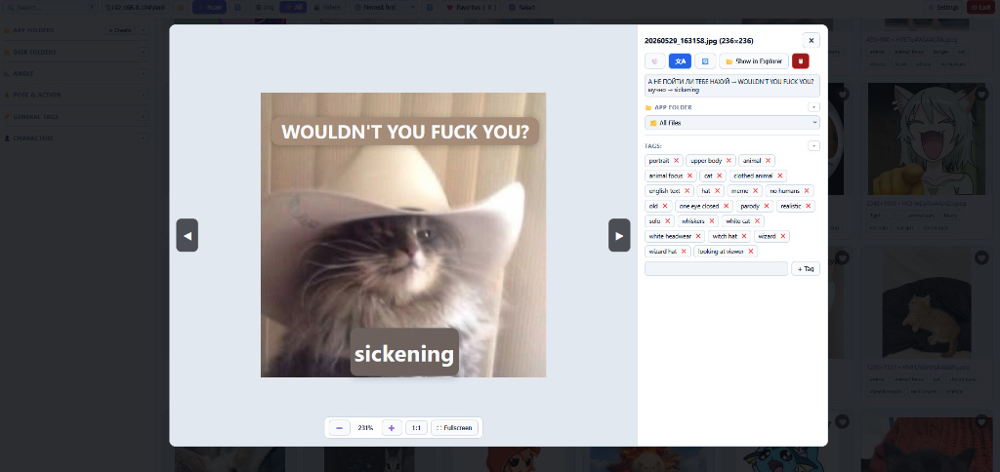

# Kokekbooru

**English** | [Русский](README.ru.md)

[](https://github.com/kokekk/kokekbooru/releases)
[](https://www.gnu.org/licenses/gpl-3.0)
[](#)

**Kokekbooru** is a private, local-first booru-style media library and reference organizer for artists and collectors. Keep your entire image and video archive safely on your own PC—no cloud lock-in, no telemetry, no external servers—with built-in AI auto-tagging, fast tag search, and in-image comic/text translation.



---

## Why Kokekbooru?

* **100% Local & Private:** Your files stay untouched in your own folders. Metadata, thumbnails, and settings are stored locally on your machine (`~/.kokekbooru`).
* **AI Auto-Tagging (Images & Videos):** Automatically tags illustrations, photos, and videos (via multi-frame sampling) using ONNX Runtime (`WD-EVA02-Large v3` / `WD-ViT v3`) with GPU acceleration and automatic CPU fallback.
* **Built-in OCR & Bubble Translation:** Detects text inside images (`RapidOCR` / `Windows.Media.Ocr`) and renders translated text directly over speech bubbles using either a local offline neural translator (`NLLB-200 INT8`) or optional online providers.
* **Artist & Collector Friendly:**
  * Rule34-style tag autocomplete and instant search with category filters.
  * Optional `18+` / NSFW filter mode in Settings.
  * Full **English & Russian** UI localization (plus optional Russian tag translation in RU mode).
  * **JSON Backup & Restore** so your tags and collections are always portable.



| Before Translation | After In-Image Translation |
| :---: | :---: |
|  |  |

---

## Quick Start (Windows `.exe` — Recommended)

Most users don't need Python or any developer tools:

1. Go to the **[Releases](https://github.com/kokekk/kokekbooru/releases)** page.
2. Download the latest **`Kokekbooru-Setup.exe`** installer (or the portable `.zip` archive).
3. Run the installer and launch **Kokekbooru**.
4. Your browser will open the local interface at `http://127.0.0.1:8765`.
5. Open **Settings** to add your media folders and optionally download the local AI tagger or offline translator model.

---

## Running from Source (`.py`)

If you prefer running from Python source (Windows or Linux):

### Prerequisites

* **Python 3.10+**
* *(Optional)* **FFmpeg** on your `PATH` for video thumbnails and multi-frame video tagging.
* *(Optional)* **NVIDIA CUDA** drivers for GPU-accelerated AI tagging.

### Installation & Launch

```bash
git clone https://github.com/kokekk/kokekbooru.git
cd kokekbooru

# Create and activate a virtual environment (recommended)
python -m venv .venv
# Windows:
.venv\Scripts\activate
# Linux / macOS:
source .venv/bin/activate

# Install core dependencies
pip install fastapi uvicorn pydantic pillow numpy onnxruntime
```

Run the application:

```bash
python kokekbooru.py
```

Once started, open `http://127.0.0.1:8765` in your browser (or let it open automatically).

---

## Supported Formats

* **Images:** `.jpg`, `.jpeg`, `.png`, `.webp`, `.bmp`
* **Videos:** `.mp4`, `.mkv`, `.webm`, `.mov`, `.avi`, `.m4v`, `.wmv`

---

## Data & Portability

* **Database & Settings:** `~/.kokekbooru/` (`kokekbooru.db`, `kokekbooru_settings.json`, thumbnails, logs)
* **AI Models:** `~/.kokekbooru/ai_models/`
* **Backups:** Export or restore your entire tag database anytime via **Settings → Backup & Restore (JSON)**.

---

## License

This project is licensed under the **GNU General Public License v3.0 (GPL-3.0)** — see the [LICENSE](LICENSE) file for details.
All forks and derivative works must remain open-source under the same license.

---

## Links & Support

* **Bug Reports & Feature Requests:** [GitHub Issues](https://github.com/kokekk/kokekbooru/issues)
* **Author:** [@kokekk](https://github.com/kokekk)