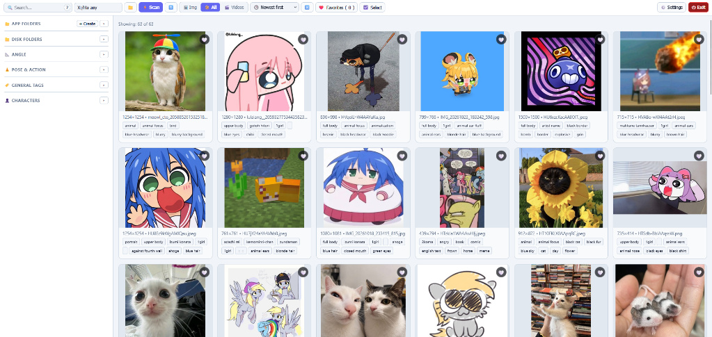
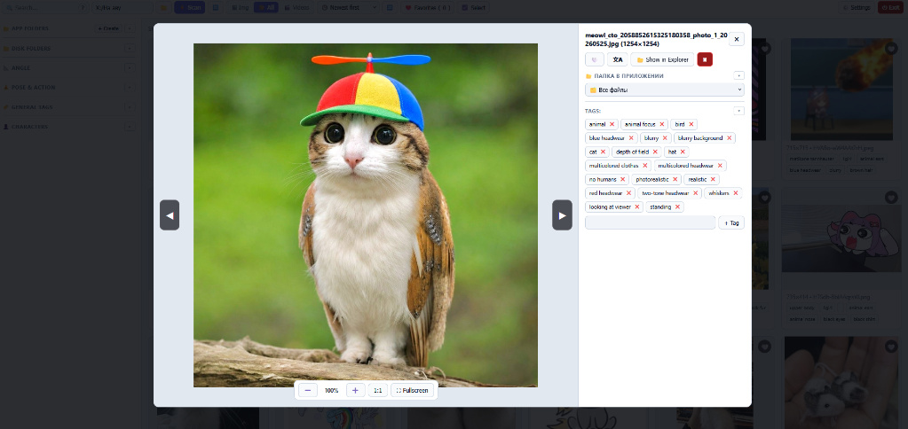
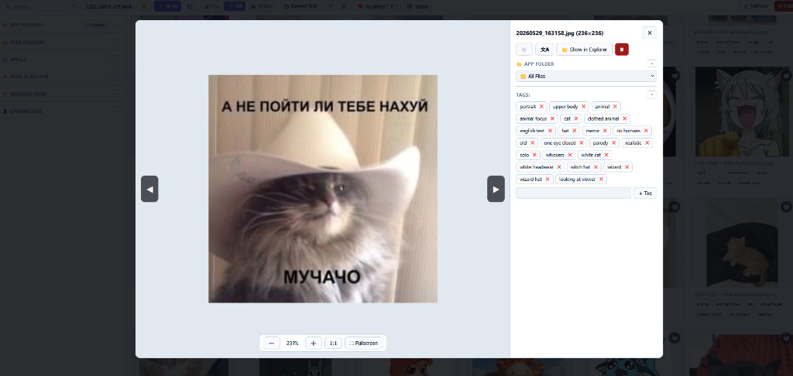
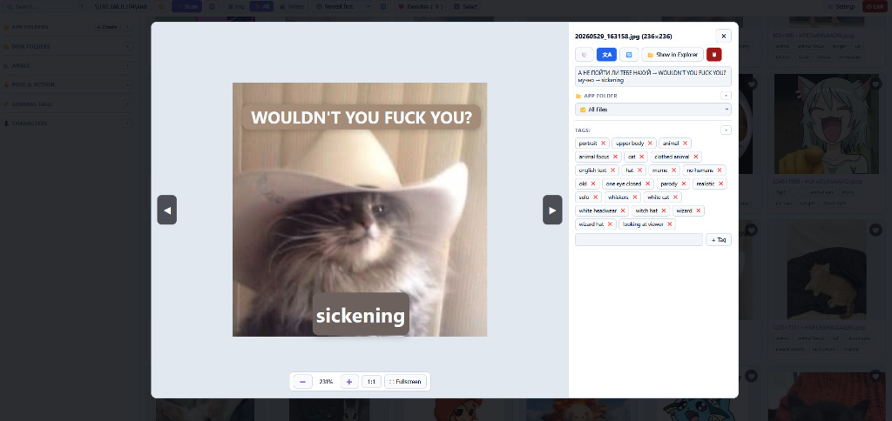

# Kokekbooru

[English](README.md) | **Русский**

[](https://github.com/kokekk/kokekbooru/releases)
[](https://www.gnu.org/licenses/gpl-3.0)
[](#)

**Kokekbooru** — приватный локальный буру-архив и менеджер референсов для художников и коллекционеров. Храните свою коллекцию артов, фото и видео прямо на собственном ПК — без облаков, телеметрии и привязки к сторонним сервисам — со встроенным ИИ-тегированием, быстрым поиском и переводом текста прямо на изображениях.



---

## Основные возможности

* **100% локально и приватно:** оригиналы файлов остаются нетронутыми в ваших папках. База данных, миниатюры и настройки хранятся локально (`~/.kokekbooru`).
* **ИИ-тегирование (фото и видео):** автоматическая расстановка тегов для изображений и видео (по выборке кадров) на базе ONNX Runtime (`WD-EVA02-Large v3` / `WD-ViT v3`) с ускорением на видеокарте и автоматическим откатом на CPU.
* **Встроенный OCR и перевод баблов:** распознаёт текст на картинках (`RapidOCR` / `Windows.Media.Ocr`) и накладывает перевод прямо поверх облачков речи — с помощью локальной оффлайн-нейросети (`NLLB-200 INT8`) или облачных переводчиков по выбору.
* **Удобно для художников и коллекционеров:**
  * Умный поиск и автодополнение тегов в стиле booru, фильтрация по категориям.
  * Опциональный режим `18+` / NSFW-фильтра в настройках.
  * Полная **русская и английская** локализация интерфейса (включая опциональный перевод тегов на русский язык).
  * **Резервное копирование (JSON):** экспорт и импорт всей базы тегов, чтобы архив не зависел от одной машины.



| До перевода | После перевода на изображении |
| :---: | :---: |
|  |  |

---

## Быстрый старт (Windows `.exe` — рекомендуется)

Для большинства пользователей Python и консоль не понадобятся:

1. Перейдите на страницу **[Releases](https://github.com/kokekk/kokekbooru/releases)**.
2. Скачайте свежий установщик **`Kokekbooru-Setup.exe`** (или портативный `.zip`-архив).
3. Установите и запустите **Kokekbooru**.
4. Локальный интерфейс автоматически откроется в браузере по адресу `http://127.0.0.1:8765`.
5. Откройте **Настройки**, укажите папки с вашей коллекцией и при желании скачайте модели ИИ-теггера и локального переводчика.

---

## Запуск из исходников (`.py`)

Для запуска на Windows или Linux напрямую через Python:

### Требования

* **Python 3.10+**
* *(Опционально)* **FFmpeg** в переменной `PATH` — для генерации превью и ИИ-тегирования видео.
* *(Опционально)* Драйверы **NVIDIA CUDA** — для ускорения ИИ-теггера на видеокарте.

### Установка и запуск

```bash
git clone https://github.com/kokekk/kokekbooru.git
cd kokekbooru

# Создание и активация виртуального окружения (рекомендуется)
python -m venv .venv
# Windows:
.venv\Scripts\activate
# Linux / macOS:
source .venv/bin/activate

# Установка базовых зависимостей
pip install fastapi uvicorn pydantic pillow numpy onnxruntime
```

Запуск программы:

```bash
python kokekbooru.py
```

После запуска интерфейс будет доступен в браузере по адресу `http://127.0.0.1:8765`.

---

## Поддерживаемые форматы

* **Изображения:** `.jpg`, `.jpeg`, `.png`, `.webp`, `.bmp`
* **Видео:** `.mp4`, `.mkv`, `.webm`, `.mov`, `.avi`, `.m4v`, `.wmv`

---

## Хранение данных и бэкапы

* **База данных и настройки:** `~/.kokekbooru/` (`kokekbooru.db`, `kokekbooru_settings.json`, миниатюры и логи)
* **ИИ-модели:** `~/.kokekbooru/ai_models/`
* **Резервные копии:** экспорт и восстановление базы тегов в пару кликов через **Настройки → Бэкап и восстановление (JSON)**.

---

## Лицензия

Проект распространяется под лицензией **GNU General Public License v3.0 (GPL-3.0)** — подробности в файле [LICENSE](LICENSE).
Все форки и производные проекты обязаны оставаться с открытым исходным кодом под той же лицензией.

---

## Ссылки и обратная связь

* **Сообщить об ошибке / предложить идею:** [GitHub Issues](https://github.com/kokekk/kokekbooru/issues)
* **Автор:** [@kokekk](https://github.com/kokekk)
